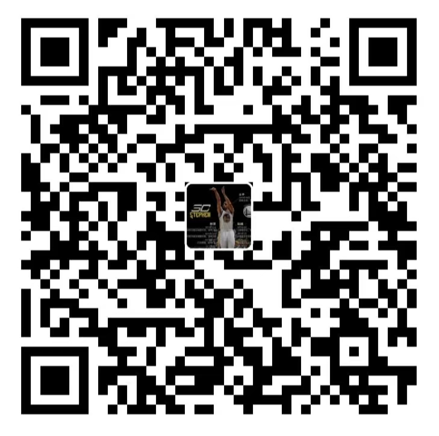

# 门牌识别工作台 · Doorplate OCR

面向中文地址与数字门牌的 Windows 本地识别软件。支持拖入图片、文件夹批量处理、人工复核，以及 CSV / JSON 导出。

**[下载 Windows x64 软件包](https://github.com/troulierkilian-blip/doorplate-ocr/releases/latest)** · [MIT 许可](LICENSE)

## 运行软件

适用于 Windows 10 / 11 x64。从 Releases 下载 `DoorplateOCR-Windows-x64-v2.0.0.zip`，解压后双击 **门牌识别工作台.exe**。
发布版内置运行库及 OCR 模型，无需安装 Python，识别时无需联网，也不会上传图片。启动时会在当前用户的应用缓存目录展开资源，正常退出后清理临时资源。

1. 拖入单张或多张图片、一个或多个文件夹，也可以使用导入按钮。默认自动识别并包含子文件夹。
2. 点击结果列表查看原图、文字框、中文地址、数字门牌号、识别得分和复核提示。
3. 使用搜索框与状态筛选查找记录；滚轮缩放图片，按住鼠标拖动，或点击“适应窗口”。
4. 核对并编辑地址或门牌号，点击“保存修正”，再导出 CSV 或 JSON。退出前请导出，列表不会自动恢复。
5. 批量处理可取消，已完成记录会保留；损坏图片记录失败原因后继续处理其余图片。

支持 JPG、JPEG、PNG、BMP、WEBP，以及中文、空格路径和照片方向信息。同一路径重复导入会去重。
基础 OCR 和门牌增强模式共用识别引擎；增强模式按需比较放大、局部对比度增强和可靠透视候选。
解析支持分开的汉字、地址中的数字、连接符门牌及前导零，但不能保证每张图片都识别正确。

**得分是识别模型的输出分数，不是正确率。** 模糊、遮挡、裁切、细数字和连接符仍需人工核对。
地址字段主要对应门牌的主要水平标题，不保证组成完整行政地址。CSV 用 Excel 导入时，请将门牌号列设置为文本；JSON 会保留原始字符串。

快捷键：`Ctrl+O` 导入图片、`Ctrl+F` 搜索、`Ctrl+E` 导出、`Esc` 取消任务。
本仓库不附带课程图片或其他课程资料；“课程素材”按钮未找到默认素材时会打开文件夹选择框，可选择自己的图片目录。

## 从源码运行

使用 Windows x64 与 Python 3.10。首次安装依赖需要联网，之后模型通过已安装的 RapidOCR 包在本地使用。

```powershell
git clone https://github.com/troulierkilian-blip/doorplate-ocr.git
cd doorplate-ocr
py -3.10 -m venv .venv
.\.venv\Scripts\python.exe -m pip install -r requirements-lock.txt
.\.venv\Scripts\python.exe app.py
```

`requirements.txt` 列出主要运行依赖，`requirements-lock.txt` 固定此次发布使用的运行与打包依赖。

## 命令行批处理

```powershell
.\.venv\Scripts\python.exe cli.py --input "图片目录" --output "结果.csv" --mode enhanced
.\.venv\Scripts\python.exe cli.py --input "门牌 图片.jpg" "另一个文件夹" --output "结果.json" --mode base
```

文件夹默认递归，添加 `--no-recursive` 只处理当前层。`--variant scale|contrast|perspective` 可指定单项增强。
桌面界面与命令行调用同一个 `DoorplateEngine`。有损坏图片时仍导出其他结果并返回非零退出码；无可处理图片时返回 2。

## 构建 Windows EXE

在上述环境中运行：

```powershell
.\构建发布版.ps1
```

输出为 `发布版\门牌识别工作台.exe`（单文件）和 `发布版\DoorplateOCR\`（目录便携版）。
单文件可独立复制；目录便携版必须整体保留其 `_internal` 资源目录。构建脚本使用 Windows 自带的微软雅黑生成图标，无需 Microsoft Word。

## 技术与许可

- 界面：Python、Tkinter、TkinterDnD2；图像处理：OpenCV、Pillow。
- 本地推理：RapidOCR 1.4.4、ONNX Runtime CPU；检测和识别使用 PP-OCRv4，方向分类使用 PP-OCRv2。
- 使用预训练模型，本项目不在课程数据上训练神经网络，也不根据文件名补全识别答案。

原创代码采用 [MIT License](LICENSE)。模型和第三方依赖继续适用各自的许可证；详见 [第三方说明](THIRD_PARTY_NOTICES.md) 与 [许可目录](第三方许可)。

## 支持项目

如果「门牌识别工作台」帮到了你，欢迎通过支付宝或微信扫码打赏。感谢你的支持！

| 支付宝 | 微信 |
| :---: | :---: |
|  |  |
